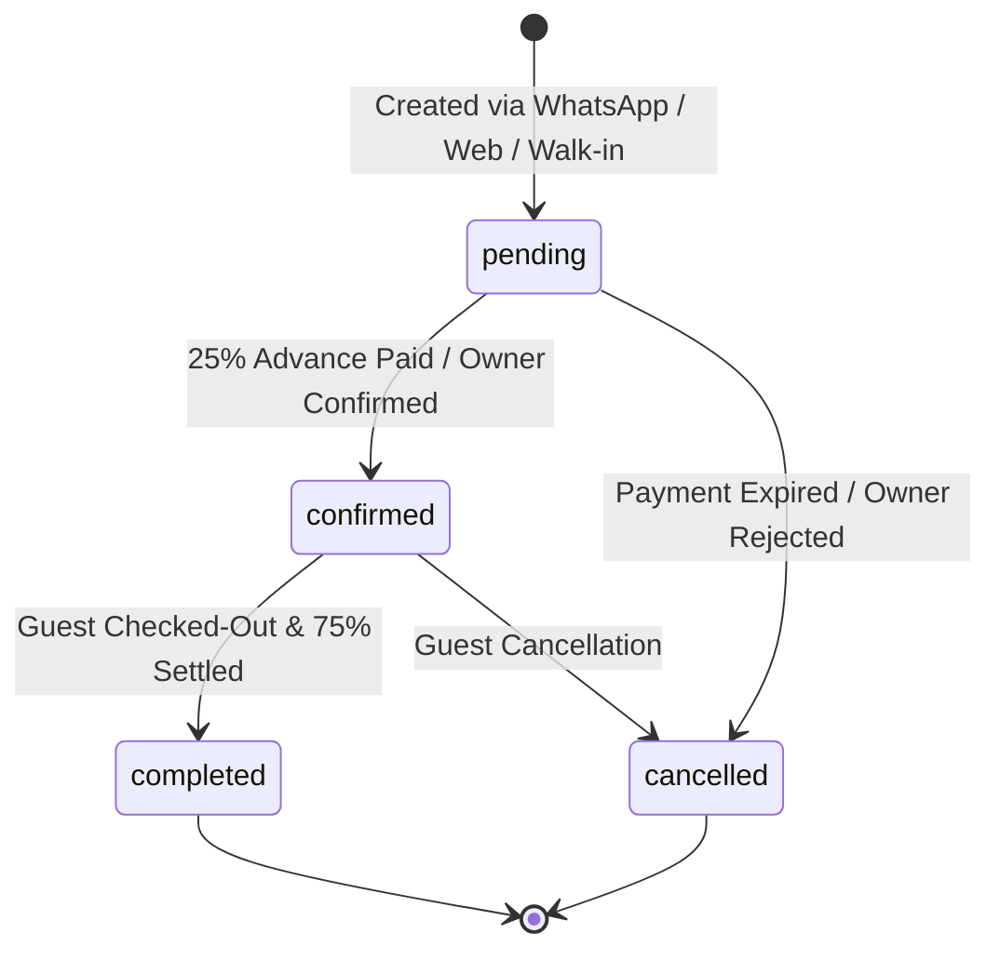

# 🏔️ DevBhoomi Stay
> **AI-Powered WhatsApp & Web Hotel Booking Platform for Uttarakhand (Lansdowne & Kotdwar)**

DevBhoomi Stay is a specialized travel-tech hospitality aggregation platform designed to connect tourists traveling to Lansdowne and Kotdwar with curated boutique hotels, mountain resorts, and heritage homestays. The platform supports seamless discovery and reservations through an automated **WhatsApp Chatbot** and a responsive **Web Portal**, powered by Razorpay token payments and automated PDF voucher dispatch.

---

## 📑 Table of Contents
1. [Platform Overview & Architecture](#-platform-overview--architecture)
2. [Tech Stack](#-tech-stack)
3. [Hotel & Homestay Owner: Full Capabilities (Owner Kya-Kya Kar Sakta Hai)](#-hotel--homestay-owner-full-capabilities)
4. [End-to-End Owner User Journey Map](#-end-to-end-owner-user-journey-map)
5. [Owner Daily Operational Workflow](#-owner-daily-operational-workflow)
6. [Dynamic Seasonal Pricing Engine](#-dynamic-seasonal-pricing-engine)
7. [Booking Lifecycle & Status State Machine](#-booking-lifecycle--status-state-machine)
8. [Role-Based Access Control: Owner vs Admin](#-role-based-access-control-owner-vs-admin)
9. [Complete Owner REST API Reference](#-complete-owner-rest-api-reference)
10. [Local Development & Setup Guide](#-local-development--setup-guide)
11. [Documentation Links](#-documentation-links)

---

## 🏛️ Platform Overview & Architecture

DevBhoomi Stay is structured as a full-stack mono-repository consisting of three main modules:

```
DevBhoomi-Stay/
├── 📁 server/        # Node.js + Express 5 REST API, WhatsApp Engine & Business Logic
├── 📁 client/        # Tourist Public Website & Integrated Portal (React 19 + Vite)
├── 📁 owner/         # Dedicated Hotel & Homestay Owner Partner Portal (React 19 + Vite, Port 5176)
├── 📁 admin/         # Super Admin Operations & Platform Governance Console (React 19 + Redux, Port 5175)
└── 📁 docs/          # In-depth Role Blueprints & System Architecture Specs
    ├── ADMIN_README.md  # Complete Super Admin Blueprint & Dashboard Specification
    └── OWNER_README.md  # Complete Property Owner User Journey & Partner Portal Spec
```

### Key Architectural Components:
* **WhatsApp Chatbot Engine:** Meta Cloud API webhook with conversational flows for destination choice (Lansdowne/Kotdwar), dates, budget, guest count, hotel cards, Razorpay payment link, and PDF voucher delivery.
* **Property Owner Partner Portal (`/owner`):** Dedicated portal for hotel & homestay hosts to manage inventory, rates, check-ins, and guest arrivals.
* **Super Admin Control Console (`/admin`):** Cross-property monitoring, onboarding approvals, revenue audit, and bot health.
* **25% Advance Token Financial Model:** Tourists pay an advance 25% token online via Razorpay to confirm their booking, while the remaining 75% balance is paid directly to the hotel owner upon check-in.

---

## 💻 Tech Stack

| Layer | Technologies |
| :--- | :--- |
| **Backend API** | Node.js (ES Modules), Express 5, MongoDB, Mongoose 9, JWT, bcryptjs |
| **Frontend Clients** | React 19, Vite, Tailwind CSS 4, Framer Motion, React Router v7, React Icons |
| **State Management** | React Context (Client/Owner), Redux Toolkit (Admin) |
| **Media & Storage** | Cloudinary (Multi-image upload for hotels, room galleries, banners) |
| **Payments** | Razorpay Payment Links & Webhooks (HMAC SHA-256 signature verification) |
| **Voucher Engine** | PDFKit (Auto-generates branded PDF vouchers with QR/booking reference) |
| **Omni-Channel** | Meta WhatsApp Business Cloud API (Interactive lists, buttons, flows) |

---

## 🏨 Hotel & Homestay Owner: Full Capabilities

Ek Property Owner DevBhoomi Stay platform par apni property ko autonomously run karne ke liye **ye sabhi actions** perform kar sakta hai:

### 1. Hotel & Storefront Management
* **Property Profile Updation:** Hotel ka display name (`hotelName`), description, contact number, emergency phone, aur email address edit karna.
* **City & Address Configuration:** Street address, city (`Lansdowne` ya `Kotdwar`), state (`Uttarakhand`), aur Google Maps navigation link set karna (jo WhatsApp bot guest ko provide karta hai).
* **Check-In / Check-Out Policies:** Standard check-in time (e.g. `12:00 PM`) aur check-out time (e.g. `11:00 AM`) define karna.
* **Property Type:** Homestay, Budget Hotel, Deluxe Hotel, ya Luxury Resort select karna.
* **Amenities Checklist:** Property par available suvidhayein switch on/off karna:
  * `WiFi`, `Free Parking`, `Mountain / Valley View`, `Geyser / 24x7 Hot Water`
  * `Bonfire`, `Lawn / Garden`, `Restaurant / In-house Kitchen`, `Room Service`, `Power Backup`.
* **High-Definition Imagery:** Cloudinary par direct 10 gallery photos aur 1 primary cover image upload karna.

### 2. Room Categories & Capacity Control
* **Category Creation:** Nayi room categories create karna (jaise `Pine Deluxe Room`, `Himalayan Valley Suite`, `Wooden Family Cottage`).
* **Guest Capacity (`maxGuests`):** Har room category ki maximum guest capacity set karna. WhatsApp search algorithm iska use karke guests ke count ke hisaab se best room suggest karta hai.
* **Bed Configurations & In-Room Amenities:** Bed types (`King Bed`, `Twin Beds`, `Family Quad`) aur category-level features (Balcony, AC, Heater, Kettle) configure karna.
* **Category Activation:** Kisi category ko seasonally active ya temporarily inactive karna.

### 3. Physical Room Inventory & Real-Time Locks
* **Room Numbers Registry:** Apne hotel ke sabhi physical rooms (e.g. 101, 102, 201, 202) add aur view karna.
* **Live Availability Toggle (`isAvailable`):** Room ko ek click me available ya unavailable mark karna.
* **Emergency / Walk-in Room Lock:** Offline aane wale local tourist ke liye room ko instant lock karna, jisse WhatsApp bot us room ko double-book na kare.
* **Category Mapping:** Kisi bhi room ko ek category se doosri category me re-assign karna.

### 4. Dynamic Seasonal Pricing Engine
Uttarakhand me tourism seasons ke hisaab se chalta hai. Owner tariffs ko completely control kar sakta hai:
* **Normal Standard Rate:** Base weekday pricing configure karna.
* **Season Surge Pricing:** May-June Summer vacation, October-November Autumn holiday season, ya New Year snow rush ke liye high-demand surge pricing rules banana.
* **Blackout Dates:** Jab room kisi offline wedding, maintenance, ya family event ke liye reserved ho, to dates ko `blackout` declare karna taaki bot booking na le sake.
* **Priority Rule Resolution:** Multiple overlapping rules me priority index set karna (higher priority automatically base rate ko override karti hai).
* **Live Rate Simulator:** Kisi bhi date par lagne wala final price query karke check karna.

### 5. Bookings & Guest Management
* **Live Bookings Feed:** Sabhi incoming reservations ko status-wise monitor karna (`pending`, `confirmed`, `completed`, `cancelled`).
* **Guest Information Card:** Guest ka pura naam, verified WhatsApp phone number, email, check-in aur check-out dates, total nights, aur room category inspect karna.
* **Financial Ledger Breakdown:** Total room tariff, Razorpay se jama hua 25% online advance deposit, aur hotel counter par collect hone wala 75% remaining balance dekhna.
* **Status Lifecycle Updates:**
  * `pending` booking ko verify karke `confirmed` banana ya invalid hone par `cancelled` karna.
  * Check-in ke baad guest ke check-out hone par `completed` mark karna.
* **Offline Walk-in Booking Creation:** Reception counter par direct aane wale tourist ki booking create karna (with atomic lock protection).

### 6. Booking Vouchers & WhatsApp Integration
* **Digital PDF Voucher Review:** Har booking ka branded DevBhoomi Stay booking voucher preview aur download karna.
* **One-Click WhatsApp Contact:** Guest ke WhatsApp par click karke check-in time coordinate karna aur hill driving directions share karna.

---

## 🗺️ End-to-End Owner User Journey Map

```mermaid
journey
    title Complete Daily Journey of a DevBhoomi Stay Property Owner
    section 1. Morning Shift (08:00 AM)
      Login to Owner Partner Portal: 5: Owner
      Review Today's Expected Arrivals: 5: Owner
      Verify Night's WhatsApp Bookings: 4: Owner
      Check Housekeeping & Room Clean Status: 4: Owner
    section 2. Departures & Check-Out (11:00 AM)
      Inspect Departing Guests: 5: Owner
      Collect Room Incidentals & Settle Bill: 5: Owner
      Mark Booking Status as Completed: 5: Owner
      Release Room for Cleaning: 5: Owner
    section 3. Arrivals & Check-In (01:00 PM)
      Greet Arriving Tourists at Lansdowne/Kotdwar: 5: Owner
      Scan / Verify WhatsApp PDF Voucher: 5: Owner
      Collect Remaining 75% Balance (Cash / UPI): 5: Owner
      Hand over Room Keys & Update Status: 5: Owner
    section 4. Dynamic Pricing & Inventory Locks (04:00 PM)
      Review Weekend Occupancy Calendar: 4: Owner
      Configure Surge Tariff for Festival Weekend: 4: Owner
      Lock Room 102 for Offline Walk-in Guest: 5: Owner
    section 5. Evening Audit & Closure (09:00 PM)
      Reconcile 75% Desk Collections with Ledger: 5: Owner
      Review Tomorrow's Check-in Schedule: 4: Owner
      Secure Logout: 5: Owner
```

---

## 🔄 Owner Daily Operational Workflow

1. **Portal Login:** Owner `/owner/login` par apne registered email aur secure password se sign in karta hai.
2. **Dashboard Overview:** Dashboard par property occupancy, expected check-ins, advance deposits, aur pending counter dues ka real-time snapshot milta hai.
3. **Managing Check-ins:**
   - Tourist reception par pahunchta hai aur WhatsApp par mila PDF voucher dikhata hai.
   - Owner booking ID verify karta hai aur 75% remaining payment collect karta hai.
   - Status ko `confirmed` se `completed` checkout tak manage kiya jata hai.
4. **Handling Offline Walk-ins:**
   - Agar bina booking ke tourist room lene aata hai, to owner Dashboard se **`+ Walk-in Booking`** create karta hai ya us room ka **Availability Toggle OFF (Lock)** kar deta hai taaki WhatsApp bot par double-booking na ho sake.
5. **Dynamic Tariff Adjustments:**
   - Aane wale weekend ya long holiday ke liye owner Pricing section me jakar dates select karta hai aur surge price activate karta hai.

---

## 📈 Dynamic Seasonal Pricing Engine

Uttarakhand me seasonality ke mutabiq pricing decide hoti hai:

```
+-------------------------------------------------------------------------+
| PRICING RESOLUTION HIERARCHY                                            |
|                                                                         |
| 1. Blackout Rule Active on Date?   ---> Room BLOCKED (Sold Out)         |
| 2. Season Surge Rule Active?       ---> Applies Surge Tariff (e.g. ₹4.5k) |
| 3. Normal Room Rule Active?        ---> Applies Base Tariff (e.g. ₹2.8k)  |
| 4. No Custom Rule Configured?      ---> Applies Hotel Default Rate      |
+-------------------------------------------------------------------------+
```

### Supported Pricing Types:
* `normal`: Regular weekday / non-peak season tariff.
* `season`: High-demand holiday spikes (Summer vacations, Diwali, Christmas/New Year, Long Weekends).
* `blackout`: Dates jab property kisi offline bulk group, wedding, ya maintenance ke liye band ho.

---

## 🔁 Booking Lifecycle & Status State Machine



### Strict Transition Rules:
* `pending` ➔ `confirmed` | `cancelled`
* `confirmed` ➔ `completed` | `cancelled`
* Ek baar `completed` ya `cancelled` hone ke baad status change nahi kiya ja sakta.

---

## ⚖️ Role-Based Access Control: Owner vs Admin

| Platform Capability | Property Owner | Super Admin |
| :--- | :---: | :---: |
| **Login Route** | `/owner/login` | `/admin/login` |
| **Dashboard Scope** | Apne single hotel ka data | Platform-wide (Sabhi hotels & revenue) |
| **Edit Hotel Details, Amenities & Timings** | ✅ Own Hotel Only | ✅ Any Hotel |
| **Upload Photos & Cover Image** | ✅ Own Hotel Only | ✅ Any Hotel |
| **Delete / Remove Hotel from Platform** | ❌ No Permission | ✅ Full Authority |
| **Create & Update Room Categories** | ✅ Own Hotel Only | ✅ Any Hotel |
| **Add / Lock / Unlock Physical Rooms** | ✅ Own Hotel Only | ✅ Any Hotel |
| **Configure Seasonal Tariffs & Blackout Dates** | ✅ Own Hotel Only | ✅ Any Hotel |
| **View Bookings & Guest Contacts** | ✅ Own Hotel Only | ✅ All Platform Bookings |
| **Create Walk-in / Direct Bookings** | ✅ Own Hotel Only | ✅ Any Hotel |
| **Update Booking Status (Confirm / Complete)** | ✅ Own Hotel Only | ✅ Any Hotel |
| **Manage Platform Users & Assign Hotels** | ❌ No Permission | ✅ Full Access |
| **WhatsApp Chatbot Session Logs & Analytics** | ❌ No Permission | ✅ Full Access |
| **Razorpay API Keys & Webhook Payloads** | ❌ No Permission | ✅ Full Access |

---

## 📡 Complete Owner REST API Reference

Sabhi Owner endpoints par `Authorization: Bearer <JWT>` header required hai jiska payload role `owner` hona zaroori hai.

### 1. Authentication
* `POST /api/auth/login` — Login as owner with email & password.

### 2. Hotel Profile Management
* `GET /api/owner/hotel` — Fetch logged-in owner's hotel details.
* `PUT /api/owner/hotel` — Update hotel information (name, description, contact, timings, amenities).
* `POST /api/owner/hotels/:hotelId/images` — Upload up to 10 gallery photos & 1 cover image via Multer/Cloudinary.

### 3. Room Categories Management
* `POST /api/owner/room-categories` — Create a new room category (max guests, bed type, amenities).
* `GET /api/owner/room-categories` — Get all room categories for owner's hotel.
* `GET /api/owner/room-categories/:id` — Get single room category details.
* `PUT /api/owner/room-categories/:id` — Update room category details.
* `PATCH /api/owner/room-categories/:id/activate` — Activate category.
* `PATCH /api/owner/room-categories/:id/deactivate` — Deactivate category.

### 4. Physical Rooms & Inventory
* `GET /api/owner/rooms` — List all physical rooms in owner's hotel.
* `GET /api/owner/rooms/:id` — Get single room details.
* `PUT /api/owner/rooms/:id` — Update room details.
* `PATCH /api/owner/rooms/:id/availability` — Toggle room availability / lock (`isAvailable: true/false`).
* `PATCH /api/owner/rooms/:id/category` — Assign room to a specific category.

### 5. Dynamic Seasonal Pricing
* `POST /api/owner/rooms/:roomId/pricing` — Create new tariff rule (`normal`, `season`, `blackout`).
* `GET /api/owner/rooms/:roomId/pricing` — Get all tariff rules for a room.
* `PATCH /api/owner/room-pricing/:id` — Update pricing rule.
* `PATCH /api/owner/room-pricing/:id/activate` — Activate pricing rule.
* `PATCH /api/owner/room-pricing/:id/deactivate` — Deactivate pricing rule.
* `GET /api/owner/rooms/:roomId/pricing/applicable?date=YYYY-MM-DD` — Check applicable price for any date.

### 6. Bookings & Reservations
* `GET /api/owner/bookings` — Get all bookings for owner's hotel.
* `GET /api/owner/bookings/:bookingId` — Get full booking details with guest info & pricing snapshot.
* `POST /api/owner/bookings` — Create walk-in / manual booking for offline guest.
* `PATCH /api/owner/bookings/:bookingId/status` — Update booking status (`pending`, `confirmed`, `completed`, `cancelled`).

---

## 🚀 Local Development & Setup Guide

### 1. Prerequisites
* **Node.js**: v18.0.0 or higher
* **MongoDB**: Local MongoDB instance or MongoDB Atlas URI
* **Cloudinary Account**: For hotel and room photo uploads
* **Razorpay Test Account**: For advance payment testing

### 2. Environment Variables Setup

Create a `.env` file in `server/`:
```env
PORT=5000
MONGO_URI=mongodb+srv://<username>:<password>@cluster.mongodb.net/devbhoomi_stay
JWT_SECRET=your_super_secret_jwt_key
CLOUDINARY_CLOUD_NAME=your_cloudinary_name
CLOUDINARY_API_KEY=your_cloudinary_key
CLOUDINARY_API_SECRET=your_cloudinary_secret
RAZORPAY_KEY_ID=rzp_test_xxxx
RAZORPAY_KEY_SECRET=xxxx
WHATSAPP_PHONE_NUMBER_ID=xxxx
WHATSAPP_ACCESS_TOKEN=xxxx
WHATSAPP_VERIFY_TOKEN=xxxx
```

### 3. Installation & Running

```bash
# Terminal 1: Backend Server (Port 5000)
cd server
npm install
npm run dev

# Terminal 2: Tourist Website (Port 5173)
cd client
npm install
npm run dev

# Terminal 3: Dedicated Hotel Owner Partner Portal (Port 5176)
cd owner
npm install
npm run dev

# Terminal 4: Super Admin Console (Port 5175)
cd admin
npm install
npm run dev
```

### 4. Portal Access URLs:
* **Tourist Website:** `http://localhost:5173/`
* **Dedicated Hotel Owner Portal:** `http://localhost:5176/` (or `/login`)
* **Integrated Client Owner Route:** `http://localhost:5173/owner/dashboard`
* **Super Admin Portal:** `http://localhost:5175/admin/login`

---

## 📚 Documentation Links
* 🏨 **[Owner Role User Journey & Partner Portal Specification](docs/OWNER_README.md)**: In-depth UI design blueprint, component layouts, and owner workflows.
* 🛡️ **[Admin Role User Journey & Dashboard Specification](docs/ADMIN_README.md)**: Full guide on cross-hotel operations, chatbot monitoring, and platform governance.

---

*DevBhoomi Stay — Promoting sustainable mountain tourism in Lansdowne & Kotdwar, Uttarakhand.* 🌲⛰️
