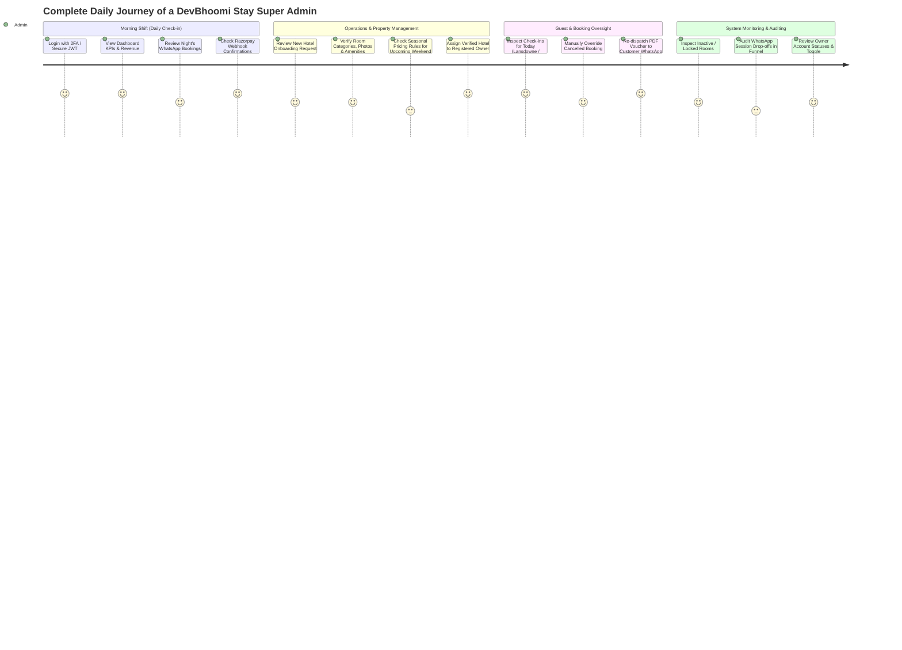

# 🏔️ DevBhoomi Stay — Admin Role User Journey & Dashboard UI Specification

> **Target Audience:** UI/UX Designers, Frontend Developers, Product Managers  
> **Platform:** DevBhoomi Stay (Boutique Stays & Homestays in Lansdowne & Kotdwar, Uttarakhand)  
> **Role Scope:** Super Admin / Operations Admin (**Full Platform Governance**)  
> **Version:** 2.0 (Production Ready)  
> **Last Updated:** October 2026  

---

## 📑 Table of Contents
1. [Executive Overview & Admin Scope](#1-executive-overview--admin-scope)
2. [Admin Sitemap & Information Architecture](#2-admin-sitemap--information-architecture)
3. [End-to-End Admin User Journey Map](#3-end-to-end-admin-user-journey-map)
4. [Role-Based Access Control (RBAC) Permissions Matrix](#4-role-based-access-control-rbac-permissions-matrix)
5. [Screen-by-Screen UI/UX Design Blueprint](#5-screen-by-screen-uiux-design-blueprint)
   - [5.1 Admin Authentication (`/admin/login`)](#51-admin-authentication-adminlogin)
   - [5.2 Executive Dashboard (`/admin/dashboard`)](#52-executive-dashboard-admindashboard)
   - [5.3 Hotel & Homestay Directory (`/admin/hotels`)](#53-hotel--homestay-directory-adminhotels)
   - [5.4 Add / Edit Hotel Studio (`/admin/hotels/:id/edit`)](#54-add--edit-hotel-studio-adminhotelsidedit)
   - [5.5 Room Inventory & Category Matrix (`/admin/hotels/:id/rooms`)](#55-room-inventory--category-matrix-adminhotelsidrooms)
   - [5.6 Pricing & Seasonal Rate Manager (`/admin/pricing`)](#56-pricing--seasonal-rate-manager-adminpricing)
   - [5.7 Bookings & Guest Management (`/admin/bookings`)](#57-bookings--guest-management-adminbookings)
   - [5.8 User & Hotel Owner Management (`/admin/users`)](#58-user--hotel-owner-management-adminusers)
   - [5.9 WhatsApp Bot & Live Sessions (`/admin/whatsapp`)](#59-whatsapp-bot--live-sessions-adminwhatsapp)
   - [5.10 Financials, Razorpay & Webhook Logs (`/admin/transactions`)](#510-financials-razorpay--webhook-logs-admintransactions)
6. [Design System & UI Tokens for Figma Designer](#6-design-system--ui-tokens-for-figma-designer)
7. [API Endpoints Integration Map](#7-api-endpoints-integration-map)

---

## 1. Executive Overview & Admin Scope

**DevBhoomi Stay** is a travel-tech hospitality aggregator connecting tourists traveling to **Lansdowne** and **Kotdwar** with curated homestays, budget hotels, and luxury resorts.

The **Admin** is the supreme operational authority of the platform. Unlike a hotel owner who only manages their single property, the Admin possesses **omnipresent, cross-hotel governance**.

### Primary Admin Objectives:
1. **Onboard & Audit Properties:** Review and approve hotels/homestays, verify images, amenities, and assign them to verified local property owners.
2. **Monitor Omni-Channel Bookings:** Supervise all reservations arriving through the automated **WhatsApp Chatbot** and Web Portal.
3. **Control Pricing & Availability:** Ensure room rates, blackout dates, peak Uttarakhand tourism season spikes, and room locks are accurate.
4. **Financial Governance:** Monitor 25% advance token deposits collected via Razorpay, handle payouts to property owners, and audit refund/cancellation claims.
5. **System Health & WhatsApp Bot Supervision:** Monitor active customer WhatsApp sessions, webhook statuses, and voucher generations.

---

## 2. Admin Sitemap & Information Architecture

The Admin Portal uses a **modern left-sidebar navigation layout** with sticky top header controls (Global Search, Date Range Filter, Notification Bell, Admin Profile menu).

```
Admin Portal (/admin)
│
├── 📊 1.0 Executive Dashboard (/admin/dashboard)
│
├── 🏨 2.0 Hotel Management (/admin/hotels)
│   ├── Hotel Directory (Search, Filter by City & Type, Status Toggle)
│   ├── Add New Property Wizard (/admin/hotels/new)
│   └── Edit Property Studio (/admin/hotels/:id/edit)
│
├── 🛏️ 3.0 Room & Inventory Control (/admin/inventory)
│   ├── Room Categories & Amenities
│   ├── Physical Rooms List (Numbers, Status, Locks)
│   └── Room Availability Switcher
│
├── 💰 4.0 Pricing & Seasons (/admin/pricing)
│   ├── Standard Tariff Matrix
│   ├── Seasonal Surge Pricing Plans
│   └── Blackout Dates Calendar
│
├── 📅 5.0 Bookings & Guests (/admin/bookings)
│   ├── Live Bookings Stream
│   ├── Booking Details & Status Override
│   └── PDF Voucher Regeneration & Dispatch
│
├── 👥 6.0 User & Owner Management (/admin/users)
│   ├── Hotel Owners List
│   ├── Owner Account Creation & Hotel Assignment
│   └── Access & Password Controls
│
├── 💬 7.0 WhatsApp Engine (/admin/whatsapp)
│   ├── Live Bot Sessions & Funnel Drop-off Tracking
│   ├── Inbound WhatsApp Message Logs
│   └── Flow Diagnostic & Re-trigger
│
├── 💳 8.0 Transactions & Razorpay (/admin/transactions)
│   ├── Online Advance Payments Log
│   ├── Razorpay Webhook Events
│   └── Settlement Reconciliation
│
└── ⚙️ 9.0 Platform Settings (/admin/settings)
    ├── Regional Destination Settings (Lansdowne, Kotdwar)
    ├── Advance Percentage Rule (Default 25%)
    └── Admin Security & Cloudinary Storage
```

---

## 3. End-to-End Admin User Journey Map



---

## 4. Role-Based Access Control (RBAC) Permissions Matrix

| Feature / Resource | Super Admin | Property Owner | Regular Customer |
| :--- | :---: | :---: | :---: |
| **View System-Wide Dashboard KPIs** | ✅ Full Access | ❌ Only Own Hotel Stats | ❌ No |
| **Create / Delete Hotels** | ✅ Any Hotel | ❌ Cannot delete | ❌ No |
| **Assign Hotel to Owner** | ✅ Full Access | ❌ No | ❌ No |
| **Toggle Hotel Active / Inactive** | ✅ Full Access | ❌ Cannot deactivate approved hotel | ❌ No |
| **Create & Update Room Categories** | ✅ Any Hotel | ✅ Only Own Hotel | ❌ No |
| **Add / Delete Individual Rooms** | ✅ Any Hotel | ✅ Only Own Hotel | ❌ No |
| **Emergency Room Lock / Unlock** | ✅ Full Access | ✅ Only Own Hotel | ❌ No |
| **Configure Seasonal / Blackout Pricing** | ✅ Full Access | ✅ Only Own Hotel | ❌ No |
| **View All Platform Bookings** | ✅ Across all properties | ❌ Only Own Property | ❌ Only Own Booking |
| **Override Booking Status (Force Confirm / Cancel)**| ✅ Yes | ⚠️ Restricted | ❌ No |
| **Manage Users (Create, Deactivate, Delete)** | ✅ Full Access | ❌ No | ❌ No |
| **Inspect WhatsApp Chatbot Session Funnel** | ✅ Full Access | ❌ No | ❌ No |
| **View Raw Razorpay Webhook Payloads** | ✅ Full Access | ❌ No | ❌ No |
| **Download & Resend Any Booking Voucher PDF** | ✅ Full Access | ✅ Only Own Hotel | ✅ Only Own Voucher |

---

## 5. Screen-by-Screen UI/UX Design Blueprint

The following section defines every screen that the UI designer must create in Figma.

---

### 5.1 Admin Authentication (`/admin/login`)
* **Purpose:** High-security access gateway for platform administrators.
* **Layout:** Split layout (Left: High-resolution landscape photograph of Lansdowne hills with DevBhoomi branding; Right: Minimalist clean card with login form).
* **Key Components:**
  1. DevBhoomi Stay Brand Logo & "Admin Portal" Badge
  2. Input: `Email Address` (with validation)
  3. Input: `Password` (with show/hide toggle)
  4. "Remember this device" checkbox
  5. Action Button: `Sign In to Console` (Primary brand pine green)
  6. Security notice footer: *"Authorized administrative personnel only. IP logged."*

---

### 5.2 Executive Dashboard (`/admin/dashboard`)
* **Purpose:** The nerve center. Admin lands here immediately after logging in. Gives real-time visibility into bookings, revenue, properties, and system alerts.

#### 📌 Visual Wireframe Layout:
```
+---------------------------------------------------------------------------------------------+
| [DevBhoomi Stay Admin]      [🔍 Search bookings, hotels, guests...]     (🔔 3)  [Admin ▾]   |
+---------------------------------------------------------------------------------------------+
| Date Filter: [Today ▾] [All Locations ▾]                        [+ Onboard Hotel] [Export]  |
+---------------------------------------------------------------------------------------------+
| [💰 Total Revenue]     [📅 Active Bookings]   [🏨 Listed Stays]      [💬 Active WhatsApp]   |
|   ₹1,84,500               48 Bookings            14 Properties          22 Active Users     |
|   ↑ +18% this week        12 Check-ins Today     10 Lansdowne, 4 Kotdwar 95% Completion     |
+---------------------------------------------------------------------------------------------+
|  CHARTS ROW                                                                                 |
|  [📈 Revenue & Advance Deposits Trend]           [🥧 Bookings by Property Type]            |
|  (Bar/Area Chart: Last 30 Days)                  (Homestay vs Deluxe vs Budget vs Luxury)   |
+---------------------------------------------------------------------------------------------+
|  OPERATIONAL TABLES ROW                                                                     |
|  [🛎️ Today's Arrivals & Check-ins]               [⚠️ Critical System Alerts]                |
|  - Guest Name | Hotel | Room | Advance | Status  | - Room 301 locked > 15 mins              |
|  - 6 Confirmations pending owner approval       | - Lansdowne Homestay missing cover photo |
+---------------------------------------------------------------------------------------------+
```

#### UI Elements & Data Points:
1. **Metric Cards (Row 1):**
   * **Total Gross Revenue:** Sum of all completed bookings + advance deposits.
   * **Confirmed Bookings:** Total bookings in date range with status breakdown.
   * **Property Utilization Rate:** % of available rooms currently occupied or booked.
   * **WhatsApp Bot Conversion Rate:** Searches initiated vs bookings confirmed.
2. **Interactive Controls:**
   * Global date-picker (Today, Yesterday, Last 7 Days, This Month, Custom).
   * City selector filter (All, Lansdowne, Kotdwar).
3. **Recent Activity Stream:** Real-time log showing new bookings created via WhatsApp, payment captured events, or cancellations.

---

### 5.3 Hotel & Homestay Directory (`/admin/hotels`)
* **Purpose:** Central catalog of all registered properties in Uttarakhand.
* **Header Actions:**
  * Search Bar: Search by Hotel Name, Address, or Owner Name.
  * Filter Chips: `All (14)`, `Homestays (6)`, `Deluxe (4)`, `Budget (3)`, `Luxury (1)`.
  * City Filter: `Lansdowne`, `Kotdwar`.
  * Status Filter: `Active`, `Inactive`.
  * Primary Button: `+ Add New Property`

#### Table Columns Specification:
| Column | Component Type | Details / Actions |
| :--- | :--- | :--- |
| **Property Details** | Thumbnail + Title + Subtitle | Thumbnail photo, Hotel Name, City & Address |
| **Type** | Badge / Pill | `Homestay` (Blue), `Deluxe Hotel` (Purple), `Budget` (Gray), `Luxury` (Gold) |
| **Assigned Owner** | User Avatar + Text | Owner Name, verified badge, click to view owner profile |
| **Inventory** | Text & Counter | Total Rooms count (e.g. `8 Rooms across 3 Categories`) |
| **Price Range** | Text | Starting Price (e.g. `₹2,200 - ₹4,500 / night`) |
| **Status** | Interactive Switch / Toggle | Green switch (`Active`) vs Gray (`Inactive`). Immediate toggle with confirmation dialog. |
| **Rating** | Star rating visual | ⭐ 4.5 (from DB starRating) |
| **Actions** | Action Dropdown `(...)` | `Edit Details`, `Manage Rooms`, `View Photos`, `Delete Property` |

---

### 5.4 Add / Edit Hotel Studio (`/admin/hotels/:id/edit`)
* **Purpose:** Multi-tab rich editor to manage property metadata, imagery, and amenities.
* **Tabs Breakdown:**

#### Tab 1: Core Information
* Property Name (`hotelName`)
* Property Type dropdown (`Homestay`, `Budget Hotel`, `Deluxe Hotel`, `Luxury Hotel`)
* Assigned Owner (`owner` select dropdown linked to registered Owner users)
* Full Description textarea (`description`)
* Contact Phone & Emergency Phone (`phone`)
* Contact Email (`email`)

#### Tab 2: Location & Geo-Coordinates
* Street Address (`address`)
* City (`city` — Lansdowne / Kotdwar)
* State (`state` — default "Uttarakhand")
* Country (`country` — "India")
* Latitude & Longitude inputs (for precision map pins)
* Google Maps URL (`googleMapsUrl` — clickable link used by WhatsApp Location button)

#### Tab 3: Media Gallery (Cloudinary Integrated)
* **Cover Image Card:** Featured wide banner (ratio 16:9) with drag-and-drop replacement.
* **Gallery Photos:** Grid of uploaded hotel pictures (max 10).
  * Each photo has hover actions: `Set as Cover`, `Delete`, `Preview`.
  * Image upload dropzone with auto WebP/JPG compression indicator.

#### Tab 4: Amenities & Policy
* **Amenities Multi-Selector Tags:** Checkboxes with icons:
  * `[✓] WiFi`, `[✓] Parking`, `[✓] Restaurant`, `[✓] Garden`, `[✓] Mountain View`, `[✓] Power Backup`, `[✓] Bonfire`, `[✓] Room Service`, `[✓] Hot Water`.
* Check-In Time (`checkInTime` — e.g. "12:00 PM")
* Check-Out Time (`checkOutTime` — e.g. "11:00 AM")
* Active Platform Toggle (`isActive`)

---

### 5.5 Room Inventory & Category Matrix (`/admin/hotels/:id/rooms`)
* **Purpose:** Hierarchical room management. Properties group physical rooms under categories (e.g., Deluxe Room, Valley Suite).

```
Hotel: Green Valley Residency (Lansdowne)
├── Category 1: Deluxe Room (Max 2 Guests | King Bed)
│   ├── Room 101 [Available 🟢] [Lock: None]  [✏️ Edit]
│   ├── Room 102 [Occupied 🔴]  [Booking #B104]
│   └── Room 103 [Maintenance 🟡]
│
└── Category 2: Family Suite (Max 4 Guests | 2 Queen Beds)
    ├── Room 201 [Available 🟢]
    └── Room 202 [Available 🟢]
```

#### Key Components:
1. **Category Creator Drawer/Modal:**
   * Category Name (`Deluxe`, `Standard`, `Super Deluxe`, `Cottage`)
   * Max Guests capacity (used by WhatsApp search algorithm)
   * Bed Type (`King Bed`, `Twin Beds`, `Family Quad`)
   * Room Amenities checklist (AC, TV, Geyser, Balcony)
2. **Physical Room Table:**
   * Room Number (e.g. `101`, `204`, `Cottage-A`)
   * Associated Category
   * Operational Status (`Available`, `Occupied`, `Cleaning`, `Locked`)
   * One-click Action: `Lock Room` (prevents WhatsApp booking for walk-in offline guests)

---

### 5.6 Pricing & Seasonal Rate Manager (`/admin/pricing`)
* **Purpose:** Control dynamic tariffs. In Uttarakhand, weekend rates (Fri-Sun) and festival/summer season rates are different from weekday rates.

#### UI Features:
1. **Interactive Tariff Calendar:**
   * Visual month-grid displaying price per night on each day.
   * Color coded by tariff type:
     * 🟢 **Normal / Standard Rate:** Base weekday pricing (e.g. ₹3,000/night).
     * 🟠 **Season Rate:** Summer / Autumn surge (e.g. ₹4,500/night).
     * 🔴 **Blackout / Sold Out:** Dates blocked from WhatsApp bot bookings.
2. **Rate Rule Creator Modal:**
   * Select Hotel & Room / Category.
   * Pricing Type: `normal` | `season` | `blackout`.
   * Date Range: `Start Date` to `End Date`.
   * Price per night input (`₹`).
   * Priority Index (higher priority automatically overrides normal rate).

---

### 5.7 Bookings & Guest Management (`/admin/bookings`)
* **Purpose:** Complete master list of reservations across all homestays and hotels.

#### Table Layout:
| Booking ID | Guest Info | Hotel & Room | Dates & Duration | Tariff Breakdown | Payment Status | Actions |
| :--- | :--- | :--- | :--- | :--- | :--- | :--- |
| `#BK-94821` | **Ramesh Sharma**<br>+91 98765 43210 | Green Valley Residency<br>Deluxe (Room 101) | 28 Oct – 30 Oct<br>(2 Nights) | Total: ₹6,000<br>Advance (25%): ₹1,500 | `Paid Online` (Razorpay)<br>`Balance Due: ₹4,500` | `[📄 Voucher]` `[Override]` `[Details]` |

#### Booking Detail Slide-over Drawer:
When clicking any booking row, a detailed drawer slides in from the right:
* **Guest Card:** Name, WhatsApp Phone, Email, Number of Adults, Number of Children.
* **Stay Summary:** Check-in date & time, Check-out date & time, Total nights.
* **Financial Ledger:**
  * Total Room Tariff: ₹6,000
  * Advance Token Paid (25% via WhatsApp Razorpay): ₹1,500 (Transaction ID: `pay_P12938472`)
  * Remaining Balance to be paid at hotel check-in: ₹4,500
* **Status Override Controls:**
  * Dropdown: `Pending` | `Confirmed` | `Completed` | `Cancelled`.
  * Reason for override notes box.
* **Action Buttons:**
  * `Download PDF Voucher` (Generates the branded DevBhoomi Stay booking voucher).
  * `Resend Voucher via WhatsApp` (Directly sends PDF document to guest's WhatsApp).

---

### 5.8 User & Hotel Owner Management (`/admin/users`)
* **Purpose:** Manage platform user accounts (Hotel Owners and Administrators).

#### UI Elements:
1. **User Grid / Table:**
   * User Name & Email.
   * Role Badge: `Admin` (Purple) vs `Owner` (Teal).
   * Phone Number.
   * Managed Properties: Shows linked hotel chips (e.g. `[Green Valley Residency]`).
   * Status: `Active` vs `Deactivated`.
2. **Add New Owner Modal:**
   * Name, Email, Password, Contact Phone.
   * Role: `owner`.
   * Assign Hotel: Multi-select hotel dropdown to give that owner rights to their property.
3. **Security Toggles:**
   * Instant deactivate switch (revokes login immediately if property owner leaves platform).
   * Password reset trigger.

---

### 5.9 WhatsApp Bot & Live Sessions (`/admin/whatsapp`)
* **Purpose:** Monitor the automated WhatsApp chatbot conversations and funnel conversion live.

#### Components:
1. **Live Funnel Tracker:**
   * Step 1: Welcome & Language (`welcome`)
   * Step 2: Destination Select (`select_destination` — Lansdowne vs Kotdwar)
   * Step 3: Dates & Guests (`select_check_in`, `adults`)
   * Step 4: Budget & Hotel Type (`budget`, `hotel_type`)
   * Step 5: Hotel Search Results (`hotels_found`)
   * Step 6: Hotel Card Viewed (`hotel_details`)
   * Step 7: Advance Payment (`advance_payment`)
   * Step 8: Confirmed & Voucher Dispatched (`booking_confirmed`)
2. **Active Sessions Table:**
   * Customer Phone Number.
   * Selected Destination & Dates.
   * Current Funnel Step.
   * Last Active Timestamp.
   * Action: `Restart Session` / `Send Manual WhatsApp Text`.

---

### 5.10 Financials, Razorpay & Webhook Logs (`/admin/transactions`)
* **Purpose:** Audit online advance token payments and webhook reliability.

#### Components:
1. **Razorpay Payments Table:**
   * Payment Link ID (`plink_xxx`).
   * Razorpay Payment ID (`pay_xxx`).
   * Amount (`₹`).
   * Customer Contact.
   * Associated Booking Reference.
   * Signature Verification Status: `Verified ✅` vs `Failed ❌`.
2. **Webhook Event Log Inspector:**
   * Raw JSON payload viewer for `payment.captured` and `payment_link.paid`.
   * Delivery timestamp and HTTP response code (`200 OK`).

---

## 6. Design System & UI Tokens for Figma Designer

To ensure DevBhoomi Stay looks ultra-premium and reflects the serene hill stations of Uttarakhand:

### 🎨 Color Palette:
| Token Name | Hex Code | Usage |
| :--- | :--- | :--- |
| **Brand Primary (Pine Green)** | `#0E4D3C` | Primary buttons, active sidebar links, brand headers |
| **Brand Secondary (Deep Forest)** | `#072B22` | Sidebar background, dark modal headers |
| **Accent Gold (Himalayan Sunrise)** | `#D97706` | Star ratings, badges, "Advance Required" callouts |
| **Surface Background** | `#F8FAFC` | Main application background |
| **Card / Surface White** | `#FFFFFF` | Dashboard widgets, modals, data tables |
| **Border / Divider** | `#E2E8F0` | Subtle clean card borders and table dividers |
| **Text Primary** | `#0F172A` | Primary headings, table values |
| **Text Muted** | `#64748B` | Subtitles, labels, date stamps |
| **Success Emerald** | `#10B981` | "Confirmed" status, "Active" toggles |
| **Warning Amber** | `#F59E0B` | "Pending" payments, room locks |
| **Danger Crimson** | `#EF4444` | "Cancelled" bookings, deactivation actions |

### 🔤 Typography:
* **Font Family:** `Outfit` or `Inter` (Google Fonts).
* **Headings:** Bold / Semi-bold (24px for Page Title, 18px for Card Header).
* **Body:** Regular 14px / Line-height 1.5.
* **Data & Currency:** Semi-bold tabular figures (e.g. `₹3,000`).

---

## 7. API Endpoints Integration Map

Frontend developers can bind the UI directly to these server endpoints:

| UI Screen / Action | HTTP Method | Endpoint | Auth Required |
| :--- | :---: | :--- | :---: |
| Admin Login | `POST` | `/api/auth/login` | No |
| Get All Users (Owners) | `GET` | `/api/admin/users` | Admin JWT |
| Update User / Assign Hotel | `PUT` | `/api/admin/users/:id` | Admin JWT |
| Toggle User Active Status | `PATCH` | `/api/admin/users/:id/toggle-status` | Admin JWT |
| Get All Hotels Directory | `GET` | `/api/admin/hotels` | Admin JWT |
| Create New Hotel | `POST` | `/api/admin/hotels` | Admin JWT |
| Update Hotel Details | `PUT` | `/api/admin/hotels/:id` | Admin JWT |
| Toggle Hotel Active/Inactive| `PATCH` | `/api/admin/hotels/:id/toggle-status` | Admin JWT |
| Get Hotel Rooms | `GET` | `/api/admin/hotels/:hotelId/rooms` | Admin JWT |
| Create Room in Hotel | `POST` | `/api/admin/hotels/:hotelId/rooms` | Admin JWT |
| Lock / Toggle Room Status | `PATCH` | `/api/admin/rooms/:id/availability` | Admin JWT |
| View All Bookings | `GET` | `/api/owner/bookings` | Admin / Owner |
| Update Booking Status | `PATCH` | `/api/owner/bookings/:bookingId/status`| Admin / Owner |
| Room Pricing CRUD | `GET/POST`| `/api/owner/pricing` | Admin / Owner |
| Razorpay Webhook Events | `POST` | `/api/razorpay/webhook` | Webhook Secret |

---

> **Ready for Implementation:** This document covers 100% of the Super Admin user journey, access levels, design specs, and data bindings required to build the complete Admin Dashboard for DevBhoomi Stay.
