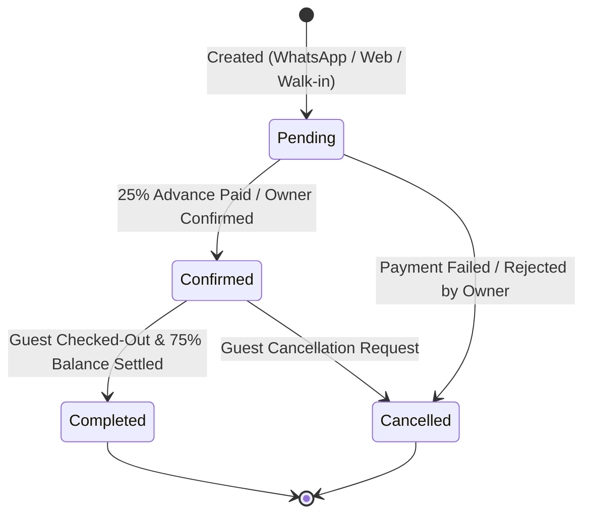
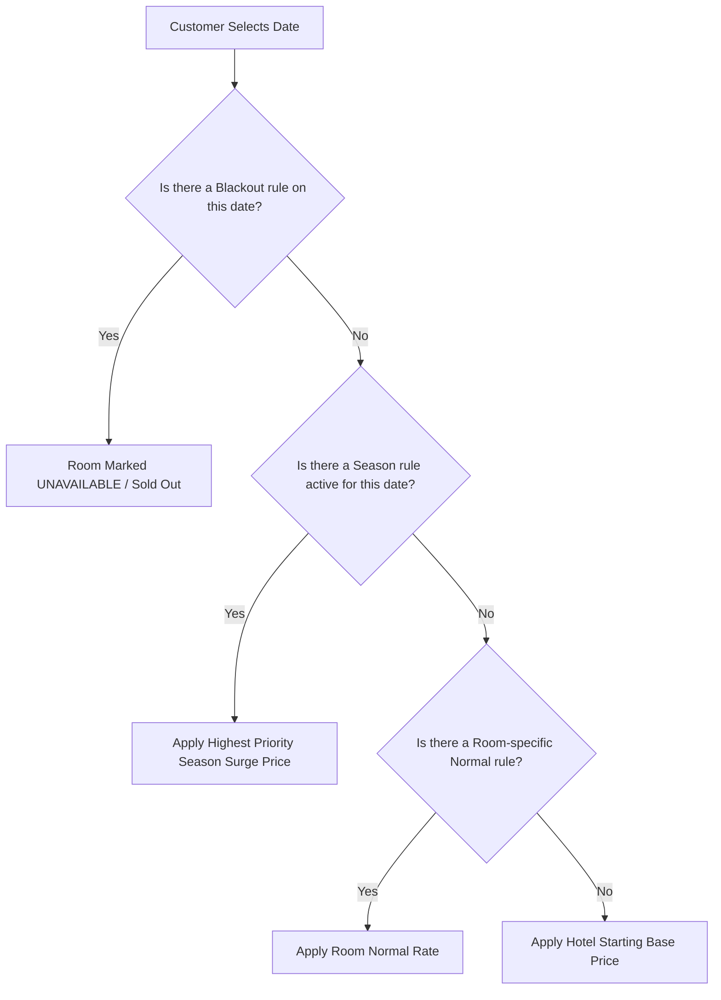

# 🏨 DevBhoomi Stay — Property Owner User Journey & Partner Portal Specification

> **Target Audience:** Hotel & Homestay Owners, UI/UX Designers, Frontend Developers, Product Managers  
> **Platform:** DevBhoomi Stay (Boutique Stays & Homestays in Lansdowne & Kotdwar, Uttarakhand)  
> **Role Scope:** Property Owner / Homestay Host (**Single Property Operations & Governance**)  
> **Version:** 2.0 (Production Ready)  
> **Last Updated:** October 2026  

---

## 📑 Table of Contents
1. [Executive Overview & Owner Role Definition](#1-executive-overview--owner-role-definition)
2. [Owner Capabilities Summary (Sab Kuchh Jo Owner Kar Sakta Hai)](#2-owner-capabilities-summary)
3. [Owner Information Architecture & Navigation Map](#3-owner-information-architecture--navigation-map)
4. [End-to-End Owner User Journey (From Onboarding to Daily Operations)](#4-end-to-end-owner-user-journey)
5. [Screen-by-Screen UI Blueprint for Owner Portal](#5-screen-by-screen-ui-blueprint-for-owner-portal)
   - [5.1 Partner Login (`/owner/login`)](#51-partner-login-ownerlogin)
   - [5.2 Owner Operations Hub / Dashboard (`/owner/dashboard`)](#52-owner-operations-hub--dashboard-ownerdashboard)
   - [5.3 My Hotel & Property Profile Studio (`/owner/hotel`)](#53-my-hotel--property-profile-studio-ownerhotel)
   - [5.4 Room Category Matrix (`/owner/room-categories`)](#54-room-category-matrix-ownerroom-categories)
   - [5.5 Physical Rooms & Real-Time Locks (`/owner/rooms`)](#55-physical-rooms--real-time-locks-ownerrooms)
   - [5.6 Dynamic Seasonal Pricing Engine (`/owner/pricing`)](#56-dynamic-seasonal-pricing-engine-ownerpricing)
   - [5.7 Bookings, Arrivals & Walk-ins Manager (`/owner/bookings`)](#57-bookings-arrivals--walk-ins-manager-ownerbookings)
   - [5.8 Financial Ledger & Payment Reconciliation (`/owner/payouts`)](#58-financial-ledger--payment-reconciliation-ownerpayouts)
6. [Booking State Machine & Operational Transitions](#6-booking-state-machine--operational-transitions)
7. [Dynamic Pricing Priority & Resolution Hierarchy](#7-dynamic-pricing-priority--resolution-hierarchy)
8. [Owner vs Admin Permissions Matrix (RBAC)](#8-owner-vs-admin-permissions-matrix-rbac)
9. [Complete Owner API Endpoints Reference](#9-complete-owner-api-endpoints-reference)

---

## 1. Executive Overview & Owner Role Definition

**DevBhoomi Stay** empowers local hospitality partners across **Lansdowne** and **Kotdwar** (Uttarakhand) to showcase their boutique hotels, hill cottages, and heritage homestays to thousands of tourists via WhatsApp and the Web.

The **Property Owner** is the primary steward of their property. While the Super Admin oversees the whole platform, the **Owner possesses autonomous, end-to-end operational authority over their specific property**:

* **Property Presentation:** Keeping photos, amenities, descriptions, check-in timings, and contact lines accurate.
* **Room Capacity & Categories:** Structuring room types (Deluxe, Family Suites, Cottages) with guest caps and bed configurations.
* **Live Inventory Locks:** Locking rooms in real-time when guests walk in offline, preventing double-bookings from WhatsApp or Web.
* **Uttarakhand Peak & Season Pricing:** Adjusting tariffs for weekends, summer holidays, autumn festival surges, and snow season.
* **Guest Hospitality & Booking Lifecycle:** Confirming incoming reservations, checking in arrivals, collecting the 75% on-site balance, and completing checkout.

---

## 2. Owner Capabilities Summary

Yahan wo **har ek cheez** listed hai jo ek Hotel/Homestay Owner DevBhoomi Stay platform par kar sakta hai:

### 🏨 1. Hotel & Property Management (`/api/owner/hotel`)
* **View Hotel Profile:** Apni property ka complete data, registration status, assigned city, address, rating aur linked owner details dekhna.
* **Edit Hotel Details:** Hotel ka naam (`hotelName`), description, contact phone (`phone`), official email (`email`), address, city (`Lansdowne` / `Kotdwar`), state, check-in time (e.g. `12:00 PM`) aur check-out time (e.g. `11:00 AM`) update karna.
* **Amenities Selection:** Hotel amenities ko select/deselect karna (e.g., WiFi, Free Parking, Mountain View, Geyser / Hot Water, Bonfire, Lawn/Garden, Restaurant, Room Service, Power Backup).
* **High-Res Photos & Cover Image Upload:** Cloudinary par direct 10 gallery photos aur 1 main featured cover photo upload karna.

### 🛏️ 2. Room Categories Management (`/api/owner/room-categories`)
* **Create New Categories:** Nayi categories banana jaise `Super Deluxe Valley View`, `Himalayan Family Suite`, `Standard Pine Room`, `Wooden Cottage`.
* **Configure Guest Capacities:** Har category ka maximum guest limit set karna (`maxGuests` — e.g. 2 adults, 4 family members), jisse WhatsApp search bot sahi room suggest kare.
* **Bed Types & Room Amenities:** Bed specifications (`King Bed`, `Twin Beds`, `Family Quad`) aur category-specific amenities (Balcony view, AC, Electric Kettle, Room Heater) define karna.
* **Activate / Deactivate Category:** Seasonal basis par kisi poori category ko enable ya temporarily disable karna.

### 🚪 3. Physical Room Inventory & Locks (`/api/owner/rooms`)
* **View All Physical Rooms:** Apne hotel ke sabhi room numbers (e.g. 101, 102, 201, Cottage-A) unke category ke sath dekhna.
* **Edit Room Specifications:** Room ka custom description, per-night default price, aur images edit karna.
* **Real-Time Availability Toggle (`isAvailable`):** Kisi bhi room ki availability ko instant `true` ya `false` karna.
* **Offline Walk-in Room Lock:** Agar koi tourist hotel reception par direct aa gaya, to owner turant us room ko lock kar sakta hai taaki WhatsApp bot us date ko room kisi aur ko na beche.
* **Category Re-assignment:** Room ko ek category se doosri category me reassign karna.

### 📈 4. Dynamic & Seasonal Pricing Engine (`/api/owner/pricing`)
Uttarakhand ke tourism me season ke anusaar rate badalte hain. Owner rates ko automatically control kar sakta hai:
* **Normal Rate:** Standard base weekday pricing configure karna.
* **Season Surge Pricing:** Summer rush (May-June), Autumn holidays (Oct-Nov), ya New Year (Dec-Jan) ke liye date-range select karke special surge rate apply karna.
* **Blackout Dates:** Jab property maintenance, private family event, ya offline bulk booking ke liye booked ho, to dates ko `blackout` mark karke automated bookings band karna.
* **Rule Priority Hierarchy:** Ek room par multiple pricing rules me priority set karna (higher priority rule base rate ko automatically override karta hai).
* **Activate / Deactivate Pricing Rules:** Ek click me seasonal rules activate/deactivate karna.
* **Simulate & Check Applicable Rate:** Kisi specific aane wali date ka final price check karna (`GET /rooms/:roomId/pricing/applicable?date=YYYY-MM-DD`).

### 📅 5. Bookings & Guest Management (`/api/owner/bookings`)
* **Live Bookings Feed:** Sabhi incoming reservations ko status wise filter karke dekhna (`All`, `Pending`, `Confirmed`, `Completed`, `Cancelled`).
* **Guest Information Card:** Guest ka naam, WhatsApp phone number, email, check-in aur check-out dates, total nights, booked room number, aur category view karna.
* **Financial Breakdown:** Total booking amount, Razorpay ke zariye aaya 25% online advance token payment, aur hotel par aakar collect hone wala 75% remaining balance dekhna.
* **Status Lifecycle Progression:**
  * `pending` booking ko verify karke `confirmed` mark karna ya `cancelled` karna.
  * Check-in ke baad guest ke check-out hone par `completed` mark karna.
* **Manual / Walk-in Booking Creation:** Counter par aaye guest ki direct booking entry karna (with atomic lock protection jo double booking rokta hai).

### 📄 6. Booking Vouchers & WhatsApp Integration
* **Inspect PDF Voucher:** Har confirmed reservation ka branded DevBhoomi Stay booking voucher preview aur download karna.
* **Guest WhatsApp Contact:** Guest ke WhatsApp number par direct click karke arrival status, travel assistance, ya driving directions share karna.

---

## 3. Owner Information Architecture & Navigation Map

```
Owner Partner Portal (/owner)
│
├── 🔑 1.0 Partner Login (/owner/login)
│
├── 📊 2.0 Operations Hub / Dashboard (/owner/dashboard)
│   ├── Property Snapshot (Occupancy %, Today's Check-ins, Pending Dues)
│   ├── Quick Actions (Create Walk-in, Emergency Lock, Rate Override)
│   └── Today's Arrival Desk
│
├── 🏨 3.0 My Property Studio (/owner/hotel)
│   ├── Hotel Core Info (Name, Description, Contact, Check-in/out)
│   ├── City & Google Maps Pin (Lansdowne / Kotdwar)
│   ├── Cloudinary Photo Gallery & Featured Cover
│   └── Hotel Amenities Checklist
│
├── 🛏️ 4.0 Inventory & Categories (/owner/inventory)
│   ├── Room Categories (Create, Edit, Bed Types, Max Guests)
│   └── Physical Rooms Grid (Room 101, 102... Status, Lock Switch)
│
├── 💰 5.0 Dynamic Pricing Manager (/owner/pricing)
│   ├── Tariff Calendar Grid
│   ├── Add Pricing Rule (Normal, Season Surge, Blackout Dates)
│   └── Rule List with Active/Inactive Toggles
│
├── 🛎️ 6.0 Bookings & Arrivals Desk (/owner/bookings)
│   ├── All Bookings Filter (Pending, Confirmed, Completed, Cancelled)
│   ├── Guest Slide-over Drawer (Advance Paid vs Due Balance)
│   ├── Status Updation (Confirm / Complete / Cancel)
│   └── New Walk-in Reservation Modal
│
└── 💳 7.0 Payouts & Settlements (/owner/payouts)
    ├── Advance Token Deposit History (25% via Razorpay)
    ├── Front-Desk Balance Collection Register (75%)
    └── Monthly Revenue Summary
```

---

## 4. End-to-End Owner User Journey

Yeh mermaid journey map ek property owner ke complete daily workflow ko darshata hai:

```mermaid
journey
    title Daily Operational Journey of a DevBhoomi Stay Hotel Owner
    section 08:00 AM — Morning Operations
      Login to Owner Portal: 5: Owner
      View Today's Expected Check-ins: 5: Owner
      Review New WhatsApp Bookings from Night: 5: Owner
      Check Room Cleaning & Housekeeping Status: 4: Owner
    section 11:00 AM — Check-Outs & Turnover
      Inspect Departing Guests: 5: Owner
      Collect Room Incidentals & Mark Booking Completed: 5: Owner
      Mark Rooms Available after Cleaning: 5: Owner
    section 01:00 PM — Check-Ins & Guest Welcome
      Greet Arriving Tourists (Lansdowne / Kotdwar): 5: Owner
      Verify Digital PDF Voucher from Guest WhatsApp: 5: Owner
      Collect Remaining 75% Tariff Balance: 5: Owner
      Hand over Room Keys & Update Status: 5: Owner
    section 04:00 PM — Dynamic Tariffs & Inventory Locks
      Review Weekend Occupancy Forecast: 4: Owner
      Add Season Surge Rule for Upcoming Holidays: 4: Owner
      Lock Room 204 for Offline Walk-in Tourist: 5: Owner
    section 08:00 PM — Night Audit & Ledger Review
      Review Total Cash/UPI Balance Collected at Desk: 5: Owner
      Check Tomorrow's Expected Arrivals: 4: Owner
      Log Out Securely: 5: Owner
```

---

## 5. Screen-by-Screen UI Blueprint for Owner Portal

### 5.1 Partner Login (`/owner/login`)
* **Purpose:** Dedicated, clean authentication portal tailored for hoteliers and homestay hosts.
* **Layout:** Centered card with pine-green and emerald accents.
* **Components:**
  1. Header: *"Hotel & Homestay Partner Portal — DevBhoomi Stay"*
  2. Input: `Registered Owner Email`
  3. Input: `Password`
  4. Submit Button: `Sign In to Property Console`
  5. Help Text: Contact DevBhoomi Support for password recovery.

---

### 5.2 Owner Operations Hub (`/owner/dashboard`)
* **Purpose:** Owner ka central nerve center. Login karte hi sabhi immediate actions yahan dikhte hain.

#### 📌 Visual Layout:
```
+--------------------------------------------------------------------------------------------------+
| [🏨 DevBhoomi Stay Partner]    Hotel: Pine Oak Resort (Lansdowne)    (🔔 2)  [Anita Negi (Owner) ▾] |
+--------------------------------------------------------------------------------------------------+
| Today's Date: 3 Nov 2026                                      [+ Walk-in Booking] [Manage Rates] |
+--------------------------------------------------------------------------------------------------+
| [🛏️ Total Rooms]       [🛎️ Today's Arrivals]   [💰 Collected Today]    [⏳ Pending Due at Desk]     |
|   8 Rooms (6 Occupied)    3 Guests Checking In     ₹14,500 Cash/UPI        ₹8,200 (75% to Collect)   |
+--------------------------------------------------------------------------------------------------+
| TODAY'S ARRIVALS & CHECK-IN DESK                                                                 |
| Guest Name     | Room        | Nights | Total Tariff | Advance (25%) | Balance Due | Action     |
| Amit Verma     | Deluxe 101  | 2      | ₹6,000       | ₹1,500 Paid   | ₹4,500      | [Check-In] |
| Neha Joshi     | Suite 201   | 1      | ₹4,500       | ₹1,125 Paid   | ₹3,375      | [Check-In] |
+--------------------------------------------------------------------------------------------------+
| LIVE ROOM INVENTORY & QUICK LOCK SWITCHER                                                        |
| Room 101 [Deluxe] 🟢 Available  [🔒 Lock]  | Room 102 [Deluxe] 🔴 Occupied (Amit Verma)          |
| Room 201 [Suite]  🟢 Available  [🔒 Lock]  | Room 202 [Suite]  🟡 Locked for Offline Guest       |
+--------------------------------------------------------------------------------------------------+
```

---

### 5.3 My Hotel & Property Profile Studio (`/owner/hotel`)
* **Purpose:** Apne hotel ke store-front data ko live update karna.
* **Sections:**
  1. **Basic Details:**
     * `Hotel Name` (Editable)
     * `Hotel Type` (Dropdown: `Homestay`, `Budget Hotel`, `Deluxe Hotel`, `Luxury Hotel`)
     * `Full Description` (Scenic view details, proximity to Lansdowne Bhulla Tal / Tip N Top)
     * `Contact Phone` & `Official Email`
  2. **Location & Directions:**
     * `Address Line`, `City` (Lansdowne / Kotdwar), `State` (Uttarakhand)
     * `Google Maps URL` (WhatsApp me tourist ko driving direction button me bheja jata hai)
  3. **Policies & Timings:**
     * `Check-In Time` (e.g., 12:00 PM)
     * `Check-Out Time` (e.g., 11:00 AM)
  4. **Amenities Grid:**
     * Checkbox chips: WiFi, Mountain View, Geyser / Hot Water, Free Parking, Bonfire, Lawn / Garden, Power Backup, In-house Kitchen, Room Service.
  5. **Cloudinary Photo Gallery:**
     * Featured Cover Image (16:9 Banner).
     * Up to 10 Gallery Photos with drag-and-drop file uploader and delete buttons.

---

### 5.4 Room Category Matrix (`/owner/room-categories`)
* **Purpose:** Kamron ke types aur unki guest capacity define karna.
* **Fields per Category:**
  * Category Name: e.g. `Deluxe Valley Room`, `Super Deluxe`, `Himalayan Family Suite`.
  * Max Guests: 1 to 8 adults/kids (Used directly by WhatsApp search matching).
  * Bed Type: `King Bed`, `Queen Bed`, `Twin Single Beds`.
  * Category Amenities: AC, Balcony with Valley View, Smart TV, Electric Kettle.
  * Status: `Active` / `Inactive`.

---

### 5.5 Physical Rooms & Real-Time Locks (`/owner/rooms`)
* **Purpose:** Har physical kamre ka status track karna aur instant room lock lagana.
* **Table Columns:**
  * `Room Number`: e.g., 101, 102, 201, Wooden Hut-1.
  * `Category`: Dropdown to reassign category.
  * `Default Base Tariff`: ₹ per night.
  * `Availability Switch`: Toggle `Active (🟢)` vs `Locked (🔴)`.
  * `Action`: Edit details.

> [!IMPORTANT]
> **Emergency Room Lock Feature:** Jab koi local tourist counter par bina booking ke aa jata hai, to owner 1 click me room lock switch off kar deta hai. Isse WhatsApp bot turant us kamre ko unavailable dikhana shuru kar deta hai, jisse double booking ka risk 0 ho jata hai.

---

### 5.6 Dynamic Seasonal Pricing Engine (`/owner/pricing`)
* **Purpose:** Uttarakhand tourism demand ke according dynamic rates lagana.
* **Pricing Types:**
  1. `normal`: Default standard rate (e.g. ₹2,500/night).
  2. `season`: High-demand surge rate (e.g. ₹4,200/night for June Summer Vacations or Dussehra/Diwali).
  3. `blackout`: Rate booking blocking (property sold-out or under renovation).
* **Rule Creation Modal:**
  * Select Room / Category
  * Rule Title (e.g. *"Christmas & New Year Peak 2026"*)
  * Date Range: Start Date `YYYY-MM-DD` to End Date `YYYY-MM-DD`
  * Tariff per Night: ₹
  * Priority Index: 1 to 10 (Higher number overrides lower rules).

---

### 5.7 Bookings, Arrivals & Walk-ins Manager (`/owner/bookings`)
* **Purpose:** Sabhi reservations ki processing aur check-in operations.

#### Operational Actions:
* **View Booking Details Drawer:**
  * Guest contact (Click to Call / WhatsApp).
  * Date of arrival & departure.
  * Nights count.
  * Advance Token (25%) received via Razorpay.
  * Balance Due (75%) to be taken at hotel counter.
* **Status Updates:**
  * `pending` ➔ `confirmed` (Click "Confirm Reservation").
  * `confirmed` ➔ `completed` (Click "Complete Check-Out & Settle").
  * `pending / confirmed` ➔ `cancelled` (Click "Cancel Booking").
* **+ New Walk-in Booking Button:**
  * Counter par aane wale offline tourist ka Name, Phone, Check-in, Check-out aur Room select karke direct confirmed booking banana.

---

## 6. Booking State Machine & Operational Transitions

DevBhoomi Stay strict booking lifecycle follow karta hai taaki financial calculation aur inventory consistency bani rahe:



### State Rules:
1. `pending` se sirf `confirmed` ya `cancelled` ho sakta hai.
2. `confirmed` se sirf `completed` (check-out) ya `cancelled` ho sakta hai.
3. `completed` ya `cancelled` hone ke baad status change nahi kiya ja sakta.

---

## 7. Dynamic Pricing Priority & Resolution Hierarchy

Jab WhatsApp Bot ya Website par kisi date ke liye hotel search hoti hai, backend is hierarchy se price calculate karta hai:



---

## 8. Owner vs Admin Permissions Matrix (RBAC)

| Feature / Action | Hotel Owner | Super Admin |
| :--- | :---: | :---: |
| **Login to Portal** | `/owner/login` | `/admin/login` |
| **View Dashboard** | Only Own Hotel | Full Platform (All Hotels) |
| **Edit Hotel Details & Amenities** | ✅ Own Hotel Only | ✅ Any Hotel |
| **Upload Hotel Photos** | ✅ Own Hotel Only | ✅ Any Hotel |
| **Delete / Deactivate Hotel from Platform** | ❌ Cannot deactivate approved hotel | ✅ Full Authority |
| **Create / Edit Room Categories** | ✅ Own Hotel Only | ✅ Any Hotel |
| **Create / Lock Physical Rooms** | ✅ Own Hotel Only | ✅ Any Hotel |
| **Configure Seasonal & Surge Pricing** | ✅ Own Hotel Only | ✅ Any Hotel |
| **View Bookings** | ✅ Own Hotel Only | ✅ All Platform Bookings |
| **Create Walk-in Booking** | ✅ Own Hotel Only | ✅ Any Hotel |
| **Mark Booking Completed / Cancelled** | ✅ Own Hotel Only | ✅ Any Hotel |
| **Manage Other Owners / Platform Users** | ❌ No Access | ✅ Full Access |
| **Inspect WhatsApp Chatbot Session Funnel** | ❌ No Access | ✅ Full Access |
| **Razorpay Webhook & Payment Gateway Config** | ❌ No Access | ✅ Full Access |

---

## 9. Complete Owner API Endpoints Reference

All owner endpoints require `Authorization: Bearer <JWT>` with role `owner`.

| Category | Method | Endpoint | Description |
| :--- | :---: | :--- | :--- |
| **Auth** | `POST` | `/api/auth/login` | Owner login with email & password |
| **Hotel** | `GET` | `/api/owner/hotel` | Fetch owner's hotel details |
| **Hotel** | `PUT` | `/api/owner/hotel` | Update hotel profile, description, amenities & timings |
| **Hotel** | `POST` | `/api/owner/hotels/:hotelId/images` | Upload up to 10 gallery photos & cover image |
| **Categories** | `POST` | `/api/owner/room-categories` | Create new room category |
| **Categories** | `GET` | `/api/owner/room-categories` | List all room categories of owner's hotel |
| **Categories** | `GET` | `/api/owner/room-categories/:id` | Get details of a single category |
| **Categories** | `PUT` | `/api/owner/room-categories/:id` | Update category details |
| **Categories** | `PATCH` | `/api/owner/room-categories/:id/activate` | Activate a category |
| **Categories** | `PATCH` | `/api/owner/room-categories/:id/deactivate` | Deactivate a category |
| **Rooms** | `GET` | `/api/owner/rooms` | List all physical rooms in hotel |
| **Rooms** | `GET` | `/api/owner/rooms/:id` | Get single room details |
| **Rooms** | `PUT` | `/api/owner/rooms/:id` | Update room data |
| **Rooms** | `PATCH` | `/api/owner/rooms/:id/availability` | Toggle room availability / lock (`isAvailable: true/false`) |
| **Rooms** | `PATCH` | `/api/owner/rooms/:id/category` | Assign room to a category |
| **Pricing** | `POST` | `/api/owner/rooms/:roomId/pricing` | Create pricing rule (`normal`, `season`, `blackout`) |
| **Pricing** | `GET` | `/api/owner/rooms/:roomId/pricing` | Get all pricing rules for a room |
| **Pricing** | `PATCH` | `/api/owner/room-pricing/:id` | Update pricing rule |
| **Pricing** | `PATCH` | `/api/owner/room-pricing/:id/activate` | Activate pricing rule |
| **Pricing** | `PATCH` | `/api/owner/room-pricing/:id/deactivate` | Deactivate pricing rule |
| **Pricing** | `GET` | `/api/owner/rooms/:roomId/pricing/applicable?date=YYYY-MM-DD` | Get effective price for a date |
| **Bookings** | `GET` | `/api/owner/bookings` | List all bookings for owner's hotel |
| **Bookings** | `GET` | `/api/owner/bookings/:bookingId` | Get single booking full details |
| **Bookings** | `POST` | `/api/owner/bookings` | Create manual / walk-in booking |
| **Bookings** | `PATCH` | `/api/owner/bookings/:bookingId/status` | Update status (`pending`, `confirmed`, `completed`, `cancelled`) |

---

> **Ready for Implementation:** This document outlines 100% of the Property Owner's features, permissions, screens, user journey, and backend integration requirements.

